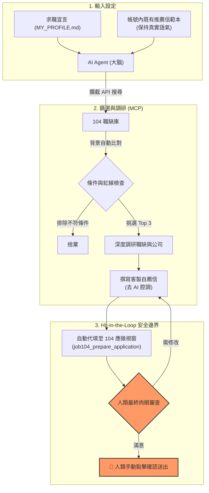

# 104 Job Hunter MCP 🏹

> 透過 MCP (Model Context Protocol) 讓 AI 直接接管 104 人力銀行的繁瑣操作。  
> 專注於精準過濾、深度調研與客製自薦信代填，拒絕無意義的亂槍打鳥。

[](https://github.com/YuJunWang/104-job-hunter-mcp)
[](https://www.typescriptlang.org/)
[](https://playwright.dev/)
[](https://modelcontextprotocol.io/)
[](https://opensource.org/licenses/ISC)
[](#-隱私與安全首要原則)

---

### 🎯 實戰淬鍊的真實故事

這套工具不是寫來展示技術的 Demo。我自己轉職 AI 工程師時，就是靠著這套流程，精準拿到面試並成功落地。

在 104 上找工作，大家一定都體會過這種無力感：
- **雜訊太多**：職缺標題寫著「AI 工程師」，點進去才發現工作內容只是資料標註，或是維護年久失修的舊系統。
- **精力有限**：認真研究公司背景、核對職缺條件、手寫客製化自薦信，一天頂多投 3 家，腦袋就乾了。
- **罐頭履歷無效**：市面上許多標榜「自動求職」的工具，本質只是狂按送出的垃圾信發報機，充滿 ChatGPT 套話，HR 一看就直接丟垃圾桶。

因此我寫了這套 MCP 工具，把 AI 當作自己的「求職特助」：  
它清楚我的技能樹、職涯目標與地雷紅線；在背景幫我擋掉 95% 不合適的職缺，挑出最吻合的 3 家；接著調出我原本存在 104 的自薦信語氣，針對職位痛點微調，並把推薦信填妥在應徵視窗裡，最後交給我親自把關確認。

這套人機協作流程幫我拿到了滿意的工作。現在我把這套系統完整開源出來。

---

## 🧭 設計原則：三道防線



### 1. 精準狙擊，不搞亂槍打鳥
AI 抓回搜尋結果後，不會一股腦把十幾頁列表倒給你。它會對照你的 `MY_PROFILE.md`，自動濾掉薪資不符、踩到地雷或技術棧差太遠的職缺，只整理出 3 到 5 筆真正值得看的選擇。

### 2. 說人話，拔除機器臭味
工具會直接讀取你 104 帳號現有的推薦信範本（`job104_get_cover_letters`），以你平常講話的習慣為底稿，針對該職缺的需求微調。徹底拿掉「深感榮幸、為貴司賦能」這種浮誇套話，把重點放在實際做過的專案邊界與解題過程。

### 3. Hit-in-the-loop：安全邊界不退讓
**這套工具絕不替你按最後的「確認送出」。**  
`job104_prepare_application` 會打開投遞彈窗、選好履歷、填入推薦信，然後停下來。投哪家、怎麼投，是你的個人職涯，最後的送出鍵必須由你親眼看過、親手按下。

---

## ✨ 核心功能與工程細節

- 🔍 **API 攔截搜尋**：監聽 104 後端 JSON API，繞過前端防爬蟲機制，並內建台灣縣市 Area Code 轉換器（輸入「台北市、新竹」會自動轉對應代碼）。
- 🏢 **深層企業調研**：利用瀏覽器內部上下文調用，繞過 104 WAF 403 阻擋，完整讀取公司簡介、福利制度與現有全部開缺。
- 🔒 **本地優先 (Local-First)**：
  - 100% 在你本機運作，不對外傳輸帳號密碼或個人資料。
  - 登入使用獨立的本機 Chrome Profile，完全由你在官方頁面操作，免除重複登入困擾。
- 🚦 **併發互斥防護 (Concurrency Protection)**：工具呼叫內建排隊互斥鎖，防止 Agent 平行發送多個請求時分頁互相搶導航而當機。

---

## 🚀 快速上手

### 1. 安裝與建置
```bash
git clone https://github.com/YuJunWang/104-job-hunter-mcp.git
cd 104-job-hunter-mcp
npm install
npm run build
```
*(環境需求：Node.js 18+、本機 Google Chrome)*

### 2. 登入 104 帳號（只需一次）
```bash
npx tsx src/login.ts
```
執行後會跳出 Chrome 視窗，請在 104 官方頁面登入。登入成功後腳本會自動儲存 Cookie 並安全關閉。

### 3. 掛載 MCP 伺服器
將設定加入你的 MCP 用戶端設定檔（例如 Antigravity 的 `mcp_config.json` 或 Claude Desktop 的 `claude_desktop_config.json`）：

```json
{
  "mcpServers": {
    "104-job-hunter": {
      "command": "node",
      "args": ["D:\\your-path\\104-job-hunter-mcp\\build\\index.js"]
    }
  }
}
```

### 4. 設定 AI 腦袋
1. 複製根目錄的 `MY_PROFILE.example.md`，命名為 `MY_PROFILE.md`。
2. 填入你的專案經驗、技能樹、薪資期望、地點與絕對紅線。
3. 直接告訴你的 AI：
   > 「請閱讀專案裡的 `MY_PROFILE.md` 與 `AGENTS.md`，照著標準劇本幫我找工作。」

---

## 🛠️ MCP 工具列表

| 工具名稱 | 用途說明 | 運作機制 |
| :--- | :--- | :--- |
| `job104_check_session` | 檢查登入是否有效 | 支援新版 `signin.104.com.tw` 跳轉判斷，避免中途卡住 |
| `job104_search` | 搜尋職缺 | 支援關鍵字與自然地名（如 `location: "台北市"`），直接攔截底層 API |
| `job104_get_details` | 讀取職缺完整內容 | 取得詳細 JD、薪資條件、加分技能與 HR 聯絡人資訊 |
| `job104_get_cover_letters` | 取得現有自薦信範本 | 讀取帳號內的預設與自訂推薦信標題與全文，保留個人原始口吻 |
| `job104_prepare_application` | 代填應徵表單 (HITL) | 開啟彈窗並填入微調後的推薦信，支援 Dry Run 截圖，**不替你送出** |
| `job104_search_companies` | 搜尋企業資訊 | 查詢公司代碼、規模、產業類別與現有職缺數 |
| `job104_get_company_detail` | 公司深度分析 | 提取企業福利文化與該公司所有在招職缺清單 |
| `job104_save_job` | 收藏職缺 | 解析職缺所屬公司並加入我的收藏名單 |
| `job104_save_company` | 追蹤公司 | 帶入完整規格 Payload 追蹤心儀企業 |
| `job104_reload_server` | 優雅重載 MCP | 伺服器更新代碼後安全發送重啟信號，不中斷 stdio 通道 |

---

## 📁 專案架構

```
104-job-hunter-mcp/
├── src/
│   ├── index.ts          # MCP 入口，註冊工具與 runExclusive 佇列防護
│   ├── browser.ts        # Playwright 瀏覽器單例管理與 fetchIn104 頁內請求封裝
│   ├── login.ts          # 互動登入與 Cookie 本地持久化腳本
│   ├── utils/
│   │   ├── url.ts        # 職缺/公司 URL 提取與新版 signin 登入網址判斷
│   │   └── area.ts       # 104 官方台灣縣市 Area Code 雙向對照工具
│   └── tools/            # 9 組核心工具實作
├── AGENTS.md             # AI 操作手冊（含去 AI 寫作原則與 4 步投遞 SOP）
├── MY_PROFILE.example.md # 求職分身設定檔範本
└── package.json          # v1.1.4
```

---

## 寫在最後

求職不該是求職者與企業人資之間的「垃圾信轟炸攻防」。  
善用 AI 替你過濾雜訊、填寫繁瑣表單，把時間和精力省下來，留給真正與未來主管、團隊交流的關鍵時刻。

希望這個專案能幫你少走一點冤枉路，順利找到合適的位置。
